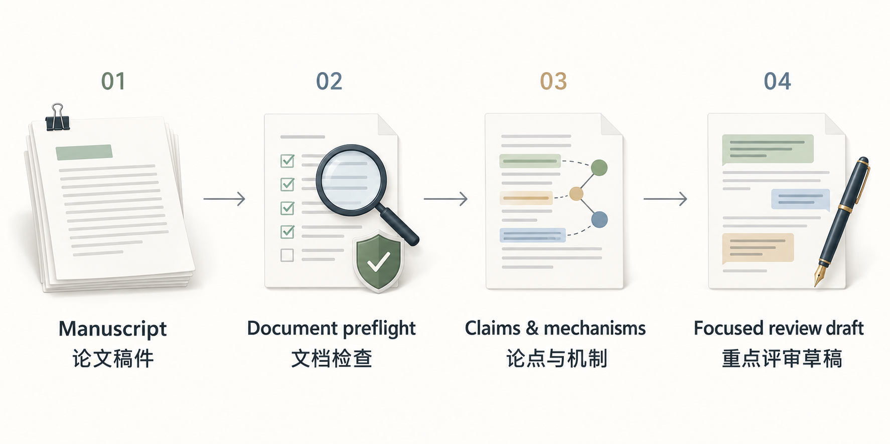

<div align="center">

<h1>More Than Peer Review</h1>
<p>Local, evidence-grounded manuscript review with focused author feedback.</p>
<p><a href="https://github.com/DELONG-L/More-Than-Peer-Review-Skill/actions/workflows/tests.yml"></a> <a href="LICENSE"></a></p>
<p><a href="#get-started"><strong>Get started</strong></a> · <a href="docs/guide.md">User guide</a> · <a href="README.zh-CN.md">简体中文</a></p>

</div>

## From manuscript to focused feedback

[](docs/illustrations/review-workflow.png)

The skill studies the whole manuscript privately, then develops a small set of connected author-facing comments around the decisive issues. It follows the problem, mechanism, assumptions, and evidence before proposing more experiments.

| Task | What you receive |
|---|---|
| Inspect a PDF or DOCX | Local preflight findings and an isolated review workspace |
| Evaluate the central contribution | A private evidence record and calibrated recommendation |
| Prepare feedback | A focused submission review with source-checked criticisms |
| Fill a requested review form | A draft mapped to the requested fields, within the user's authorization |

Confidential processing requires manuscript-scoped authorization and permission under the venue's AI policy. Bundled scripts make no network or model calls. Review analysis runs locally; requested form filling follows the user's authorization. The skill instructions define the handling and submission boundaries.

## Get started

For a fresh installation:

```bash
git clone https://github.com/DELONG-L/More-Than-Peer-Review-Skill.git
cd More-Than-Peer-Review-Skill
mkdir -p "${CODEX_HOME:-$HOME/.codex}/skills"
ln -s "$(pwd)/more-than-peer-review" "${CODEX_HOME:-$HOME/.codex}/skills/more-than-peer-review"
```

Preserve an existing installation before replacing it. Then ask:

```text
Use $more-than-peer-review to review this manuscript.
Focus on whether its mechanism and evidence support the central claim.
```

Python 3.11+ is required for the scripts; `qpdf`, Poppler, and Tesseract are recommended for document inspection. See the [user guide](docs/guide.md) for review behavior, requirements, and tests.

## Learn more

[Skill instructions](more-than-peer-review/SKILL.md) · [Document security](more-than-peer-review/references/document-security.md) · [Contribution guide](CONTRIBUTING.md) · [Third-party notices](THIRD_PARTY_NOTICES.md) · [MIT licence](LICENSE)
