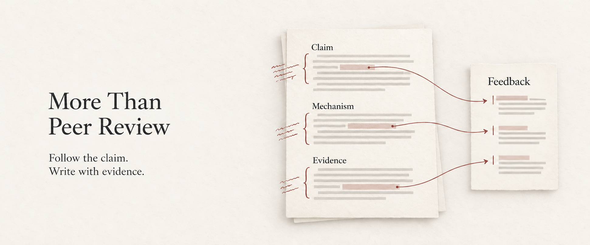

# More Than Peer Review

A Codex skill for evidence-grounded manuscript review: follow the claim, examine the mechanism, and write focused author feedback.

**[Workflow](#workflow)** · [Install](#start) · [Guide](docs/guide.md) · [简体中文](README.zh-CN.md)

<a href="#workflow"></a>

[](https://github.com/DELONG-L/More-Than-Peer-Review-Skill/actions/workflows/tests.yml) [](LICENSE)

<a id="workflow"></a>
## From manuscript to focused feedback

Study the whole manuscript in a separate review workspace, then select the issues that most affect the central claim. Check the problem, assumptions, mechanism, and evidence before proposing more experiments.

1. **Inspect the source.** Preserve the PDF or DOCX, record its digest, and use local preflight tools to examine document features and visibility gaps.

2. **Follow the argument.** Reconstruct the contribution and test the claim–mechanism–evidence chain. Rank findings by their effect on the main claim.

3. **Write focused feedback.** Develop a small set of connected comments around the decisive issues. Check criticisms against the source and align the recommendation with the findings.

## What you receive

- **A private evidence record:** the contribution map, claim-evidence checks, issue severity, and reasoning behind the recommendation.

- **Focused review text:** author-facing comments grounded in the verified record, with editor-confidential material kept in its own channel.

- **A review-form draft, when requested:** the current review mapped to the specified fields, within the user's authorization.

<details>
<summary><strong>See the output files</strong></summary>

The [skill instructions](more-than-peer-review/SKILL.md#review-workspace) define the per-manuscript workspace. Key locations include:

```text
reviews/<review-id>/
├── source/
├── security/
├── claim_evidence_matrix.csv
├── private-review.md
└── submission-review.md
```

Each manuscript keeps its own sources and analysis. The submission review is prepared from that manuscript's verified private record. Keep review workspaces and their contents outside public Git history.

</details>

<a id="start"></a>
## Get started

The scripts require **Python 3.11+**. `qpdf`, Poppler, and Tesseract are recommended for document inspection.

For a **fresh installation**:

```bash
git clone https://github.com/DELONG-L/More-Than-Peer-Review-Skill.git
cd More-Than-Peer-Review-Skill
mkdir -p "${CODEX_HOME:-$HOME/.codex}/skills"
ln -s "$(pwd)/more-than-peer-review" "${CODEX_HOME:-$HOME/.codex}/skills/more-than-peer-review"
```

Preserve an existing installation before replacing it. Then ask:

```text
Use $more-than-peer-review
to review this manuscript.
Focus on whether the mechanism
and evidence support
the central claim.
```

The [user guide](docs/guide.md) covers review behavior, installation, requirements, and tests.

## Handling and submission boundaries

Confidential processing requires authorization for that manuscript and permission under the venue's AI policy. Bundled scripts run locally and make no network or model calls. Preflight checks have limited coverage and cannot establish that a document is safe.

Form filling happens only when requested. Saving a draft and submitting a review are separate actions; final submission requires an explicit instruction for that action.

## Learn more

[Skill instructions](more-than-peer-review/SKILL.md) · [Document security](more-than-peer-review/references/document-security.md) · [Contributing](CONTRIBUTING.md) · [Third-party notices](THIRD_PARTY_NOTICES.md) · [Visual sources](docs/visuals.md) · [MIT](LICENSE)
