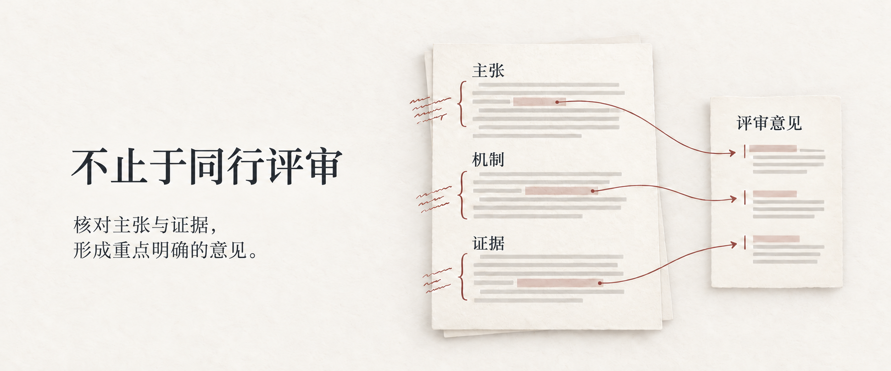

# More Than Peer Review

一个用于同行评审的 Codex 技能：核对主张、机制与证据，围绕决定性问题形成重点明确的意见。

**[评审流程](#workflow)** · [安装](#start) · [指南](docs/guide.zh-CN.md) · [English](README.md)

<a href="#workflow"></a>

[](https://github.com/DELONG-L/More-Than-Peer-Review-Skill/actions/workflows/tests.yml) [](LICENSE)

<a id="workflow"></a>
## 从稿件到重点明确的反馈

在独立的评审工作区中检查整篇稿件，再选择最影响核心主张的问题。先核对研究问题、假设、机制与证据，再判断是否需要补充实验。

1. **检查来源材料。** 保留 PDF 或 DOCX 原件，记录文件哈希，用本地预检工具检查文档特征与可见性缺口。

2. **追踪论证关系。** 重建论文贡献，检查主张、机制与证据之间的联系，按问题对核心主张的影响排序。

3. **形成重点意见。** 围绕决定性问题展开少量、相互关联的评论，对照来源核实批评依据，并保持建议与发现一致。

## 你会得到什么

- **私有证据记录：** 论文贡献、主张与证据核对结果、问题严重性，以及评审建议的判断依据。

- **重点明确的评审文本：** 基于已核对记录形成作者意见，面向编辑的保密内容保留在独立渠道。

- **按需填写的表单草稿：** 在用户授权范围内，将当前评审映射到指定字段。

<details>
<summary><strong>查看输出文件</strong></summary>

[技能说明](more-than-peer-review/SKILL.md#review-workspace)定义了每篇稿件的独立工作区，主要位置包括：

```text
reviews/<review-id>/
├── source/
├── security/
├── claim_evidence_matrix.csv
├── private-review.md
└── submission-review.md
```

每篇稿件使用各自的来源材料与分析记录，提交用评审文本由该稿件核实后的私有记录整理而成。评审工作区及其内容应保留在公开 Git 历史之外。

</details>

<a id="start"></a>
## 开始使用

脚本需要 **Python 3.11+**。文档检查建议使用 `qpdf`、Poppler 与 Tesseract。

**首次安装**：

```bash
git clone https://github.com/DELONG-L/More-Than-Peer-Review-Skill.git
cd More-Than-Peer-Review-Skill
mkdir -p "${CODEX_HOME:-$HOME/.codex}/skills"
ln -s "$(pwd)/more-than-peer-review" "${CODEX_HOME:-$HOME/.codex}/skills/more-than-peer-review"
```

已有安装时先保留本地版本。然后调用：

```text
用 $more-than-peer-review
评审这篇稿件。
重点判断方法机制与证据
能否支持核心结论。
```

更多用法与测试说明见[使用指南](docs/guide.zh-CN.md)。

## 材料与提交边界

处理保密稿件前，需要针对该稿件的授权，并确认投稿平台允许计划中的 AI 辅助。内置脚本在本地运行，不发起网络或模型调用。预检覆盖范围有限，不能据此认定文档安全。

只有用户要求时才填写评审表单。保存草稿与提交评审是两个独立动作，最终提交需要针对该动作的明确指令。

## 继续了解

[技能说明](more-than-peer-review/SKILL.md) · [文档安全](more-than-peer-review/references/document-security.md) · [贡献指南](CONTRIBUTING.md) · [第三方来源](THIRD_PARTY_NOTICES.md) · [视觉资源](docs/visuals.md) · [MIT](LICENSE)
