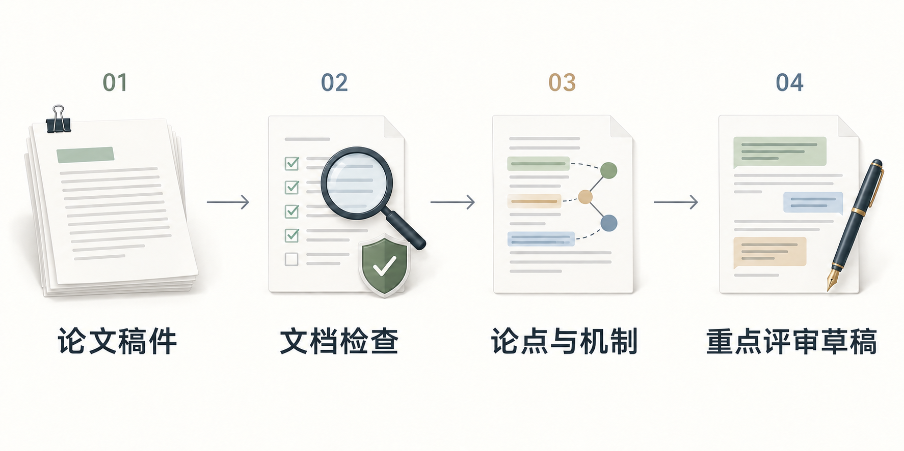

<div align="center">

<h1>More Than Peer Review</h1>
<p>在本地核对稿件证据，形成重点明确的同行评审意见。</p>
<p><a href="https://github.com/DELONG-L/More-Than-Peer-Review-Skill/actions/workflows/tests.yml"></a> <a href="LICENSE"></a></p>
<p><a href="#开始使用"><strong>开始使用</strong></a> · <a href="docs/guide.zh-CN.md">使用指南</a> · <a href="README.md">English</a></p>

</div>

## 从稿件到重点明确的反馈

[](docs/illustrations/review-workflow-zh.png)

先在私有记录中检查整篇稿件，再围绕决定性问题形成少量、相互关联的作者意见。评审首先检查问题、机制、假设与证据之间的关系，然后判断是否需要补充实验。

| 任务 | 交付内容 |
|---|---|
| 检查 PDF 或 DOCX | 本地预检结果和隔离的评审目录 |
| 判断核心贡献 | 私有证据记录和与问题严重性对应的建议 |
| 准备反馈 | 核对过依据、重点集中的作者意见 |
| 填写指定评审表单 | 按用户授权将意见映射到表单草稿 |

处理保密稿件前，需要针对该稿件的授权，并确认投稿平台允许计划中的 AI 辅助。内置脚本不发起网络或模型调用，分析工作在本地进行；只有用户要求时才填写指定评审表单。具体处理与提交边界见技能说明。

## 开始使用

首次安装：

```bash
git clone https://github.com/DELONG-L/More-Than-Peer-Review-Skill.git
cd More-Than-Peer-Review-Skill
mkdir -p "${CODEX_HOME:-$HOME/.codex}/skills"
ln -s "$(pwd)/more-than-peer-review" "${CODEX_HOME:-$HOME/.codex}/skills/more-than-peer-review"
```

已有安装时先保留本地版本。然后调用：

```text
用 $more-than-peer-review 评审这篇稿件。
重点判断方法机制与证据能否支持核心结论。
```

脚本需要 Python 3.11 或更新版本，建议安装 `qpdf`、Poppler 和 Tesseract 用于文档检查。[使用指南](docs/guide.zh-CN.md)包含评审方式、依赖与测试说明。

## 继续了解

[技能说明](more-than-peer-review/SKILL.md) · [文档安全](more-than-peer-review/references/document-security.md) · [贡献指南](CONTRIBUTING.md) · [第三方来源](THIRD_PARTY_NOTICES.md) · [MIT 许可证](LICENSE)
